<div align="center">

# Theme Loader

**A theme and dashboard store for SteamOS Game Mode.**

Browse, install, update and switch between console-style dashboards on your Steam Deck without downloading
each plugin by hand. A [Decky Loader](https://decky.xyz) plugin for the Steam Deck and other handhelds running SteamOS.

[](https://github.com/kromossomom-debug/decky-theme-loader/releases/latest)
[](https://github.com/kromossomom-debug/decky-theme-loader/releases)
[](LICENSE)
[](https://decky.xyz)
[](https://buymeacoffee.com/kromossomoc)

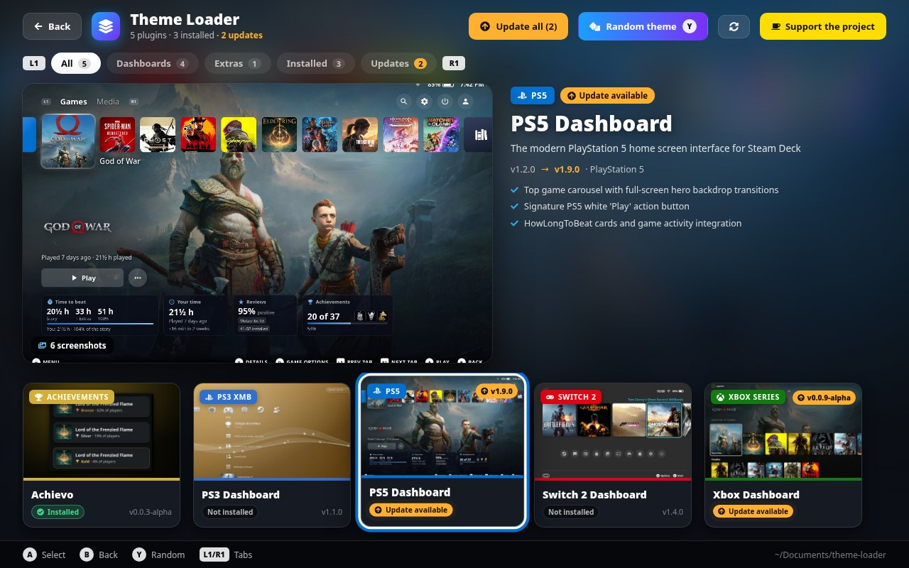

</div>

## Features

- **A full-screen store in Game Mode.** The background and the spotlight follow the item you focus: its screenshot,
  description, console badge, version and highlights. Cards show a real screenshot of each dashboard, its install
  state and its version.
- **Tabs on L1 / R1.** All, Dashboards, Extras, Installed and Updates, each with a counter.
- **Update detection.** Theme Loader compares the version installed on your Deck with the newest one it knows about
  (semantic versioning, including `-alpha` / `-beta` tags). Outdated plugins get an **Update available** badge, an
  **Update to vX** button and an **Update all** button in the header and in Quick Access.
- **Online updates.** Theme Loader reads a `catalog.json` published on GitHub, so new releases show up without
  reinstalling anything. The ZIP is downloaded, checked against its size and SHA-256 and installed. Without internet
  the store keeps working with the packages it already has.
- **Plugin pages.** A large screenshot viewer, an *Installed → In store* version panel, one-button
  install / update / reinstall, uninstall with confirmation, highlights and details (version, size, author,
  number of screenshots). Installing an older version over a newer one asks first.
- **Screenshot gallery.** Light thumbnails, full 1280×800 images loaded on demand, a filmstrip and navigation with the
  D-pad or L1 / R1.
- **Random theme (Y).** Can't decide? Roll the dice and Theme Loader installs a random theme, preferring one you
  don't have yet.
- **Self-update.** When a newer Theme Loader is available, a banner offers to update it in place.
- **Quick Access panel.** Open the store, update everything, roll a random theme and jump straight to any plugin
  from a compact list with thumbnails. Plugins with updates come first.
- **Clean full screen.** Steam's top bar (clock, battery, profile) is hidden while the store is open and comes back
  when you leave.
- **Safe installs.** ZIPs are extracted with path checks, a plugin installed under another folder name (for example
  by Decky's own store) is replaced instead of duplicated, and Theme Loader never uninstalls itself.
- **Speaks your language.** The interface follows Steam's language: English, Portuguese, German and Polish. Any other
  language gets English.

## Screenshots

| | |
|:-:|:-:|
| 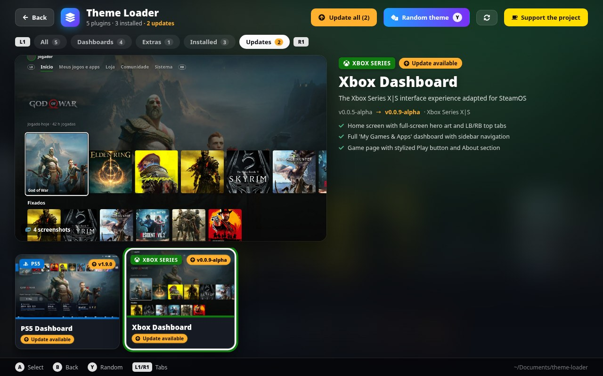<br>**Updates** tab with *Update all* | 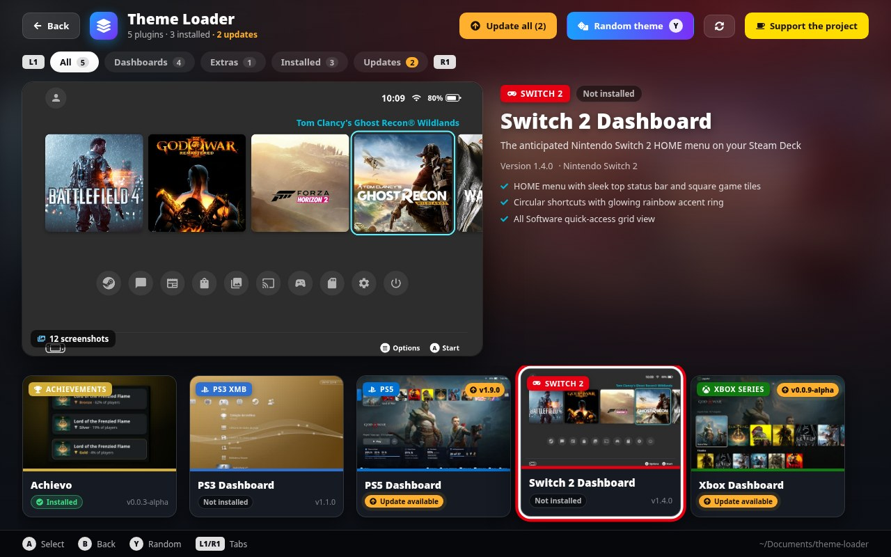<br>The spotlight follows the focused card |
| 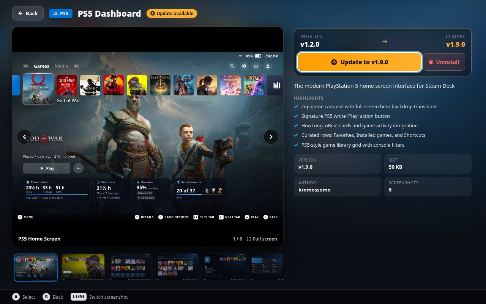<br>**Plugin page** with an update available | 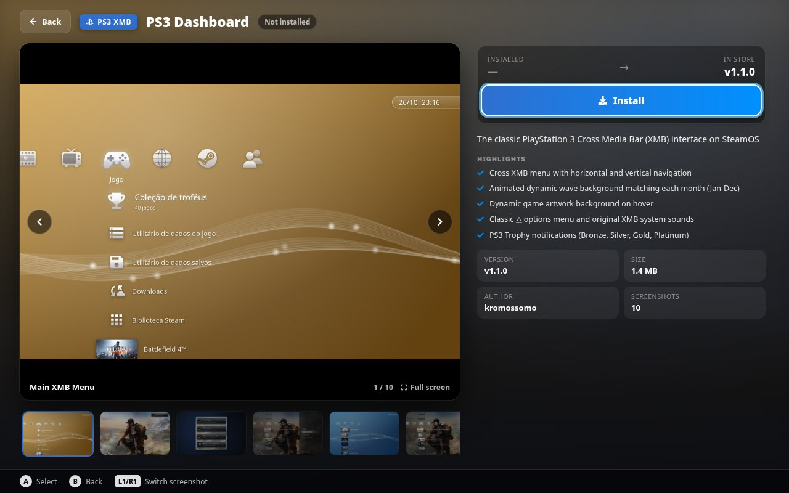<br>**Plugin page** before installing |
| 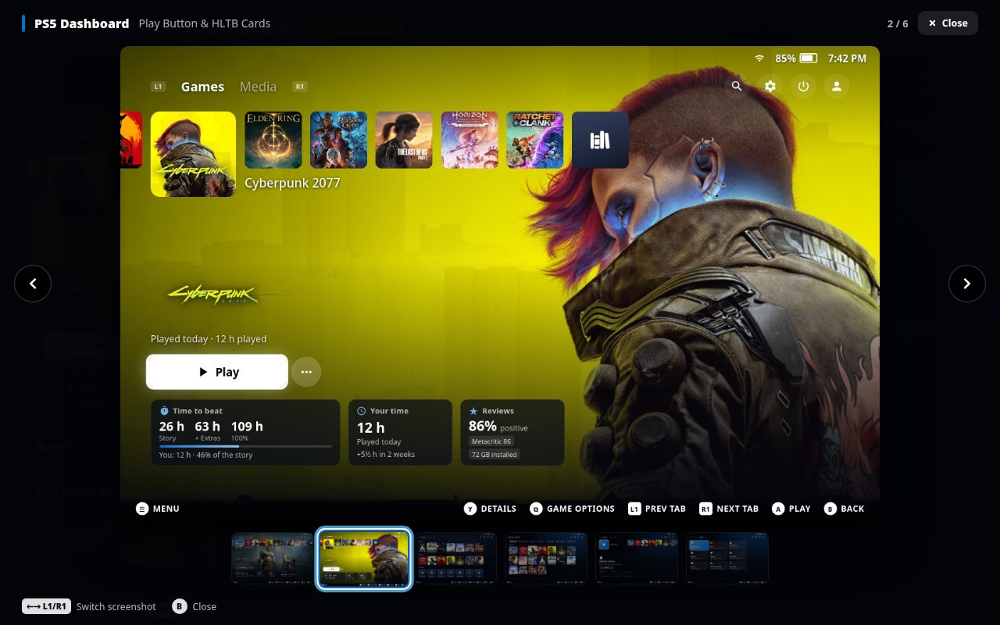<br>**Full-screen gallery** | 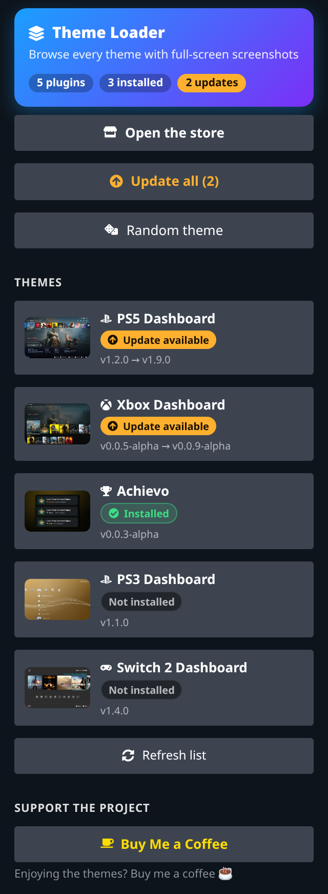<br>**Quick Access** panel |

> The store screenshots are rendered from the plugin's own interface at the Steam Deck's 1280×800 resolution, with
> sample install states (PS5 Dashboard and Xbox Dashboard set to older versions to show updates).

## What's in the store

| Plugin | What it does | Repository |
|---|---|---|
| **PS3 Dashboard** | The PlayStation 3 XMB: cross menu, monthly color waves, XMB sounds and PS3 trophies | Bundled with Theme Loader |
| **PS5 Dashboard** | The PlayStation 5 home screen: game row, white Play button, HowLongToBeat cards and PS5 colors | [decky-ps5-dashboard](https://github.com/kromossomom-debug/decky-ps5-dashboard) |
| **Switch 2 Dashboard** | The Nintendo Switch 2 HOME Menu: square tiles, round shortcuts, All Software, My Page and Basic White | [decky-switch2-dashboard](https://github.com/kromossomom-debug/decky-switch2-dashboard) |
| **Xbox Dashboard** | The Xbox Series X\|S dashboard: hero art, LB/RB tabs, My Games & Apps and the Guide | [decky-xbox-dashboard](https://github.com/kromossomom-debug/decky-xbox-dashboard) |
| **Achievo** | Xbox Series or PS5-style achievement pop-ups with sounds and 9 screen positions | [decky-achievo](https://github.com/kromossomom-debug/decky-achievo) |

You can add your own: any plugin `.zip` placed in `~/Documents/theme-loader/` shows up in the store.

## Screenshot gallery

Every screenshot shown inside the store. Click one to open it at full size.

### PS3 Dashboard

The classic PlayStation 3 Cross Media Bar (XMB) interface on SteamOS · bundled with Theme Loader

| | | |
|:-:|:-:|:-:|
| <a href="assets/screenshots/ps3-dashboard/home.jpg">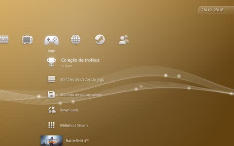</a><br><sub>Main XMB Menu</sub> | <a href="assets/screenshots/ps3-dashboard/trophy.jpg"></a><br><sub>PS3 Trophy Notification</sub> | <a href="assets/screenshots/ps3-dashboard/trophy-grades.jpg">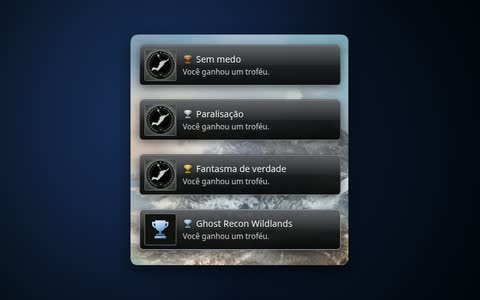</a><br><sub>Trophy Grades (Bronze to Platinum)</sub> |
| <a href="assets/screenshots/ps3-dashboard/options.jpg">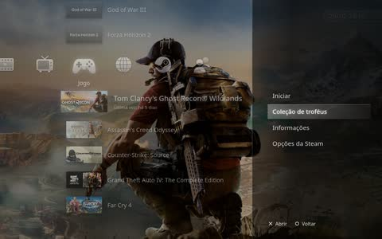</a><br><sub>△ Options Menu</sub> | <a href="assets/screenshots/ps3-dashboard/trophies.jpg">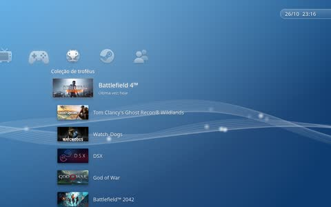</a><br><sub>Trophy Collection</sub> | <a href="assets/screenshots/ps3-dashboard/game-background.jpg">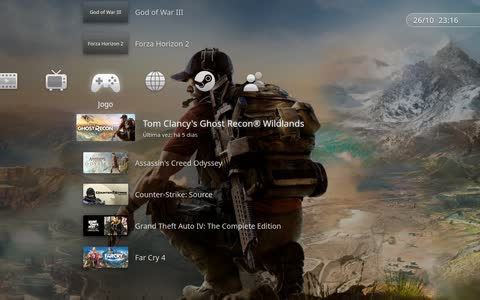</a><br><sub>Dynamic Background Art</sub> |
| <a href="assets/screenshots/ps3-dashboard/months.jpg">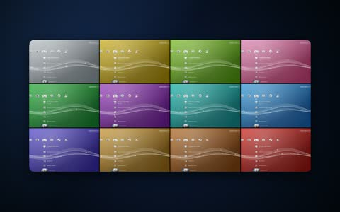</a><br><sub>12-Month Color Waves</sub> | <a href="assets/screenshots/ps3-dashboard/friends.jpg">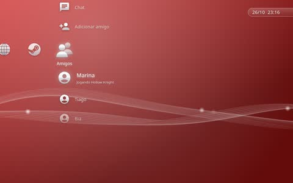</a><br><sub>Friends</sub> | <a href="assets/screenshots/ps3-dashboard/music.jpg">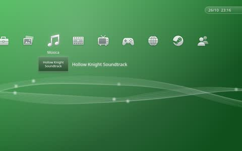</a><br><sub>Music</sub> |
| <a href="assets/screenshots/ps3-dashboard/settings.jpg">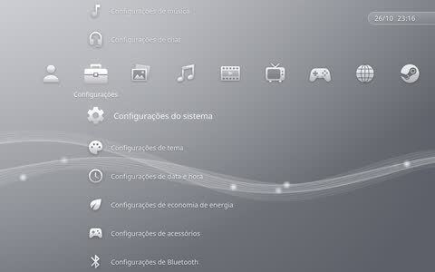</a><br><sub>Settings</sub> |  |  |

### PS5 Dashboard

The modern PlayStation 5 home screen interface for Steam Deck · [repository](https://github.com/kromossomom-debug/decky-ps5-dashboard)

| | | |
|:-:|:-:|:-:|
| <a href="assets/screenshots/ps5-dashboard/home.jpg">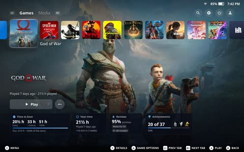</a><br><sub>PS5 Home Screen</sub> | <a href="assets/screenshots/ps5-dashboard/play.jpg">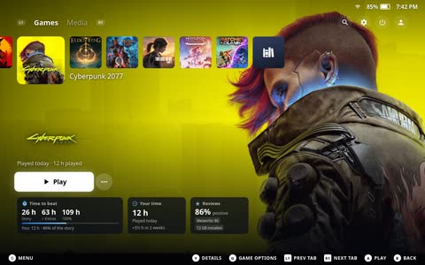</a><br><sub>Play Button &amp; HLTB Cards</sub> | <a href="assets/screenshots/ps5-dashboard/rows.jpg">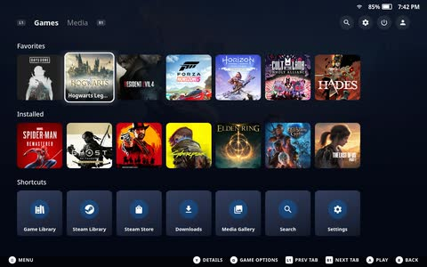</a><br><sub>Game Rows &amp; Shortcuts</sub> |
| <a href="assets/screenshots/ps5-dashboard/library.jpg">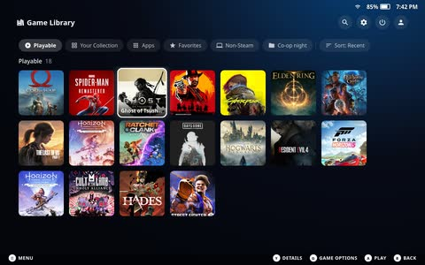</a><br><sub>Game Library</sub> | <a href="assets/screenshots/ps5-dashboard/store.jpg">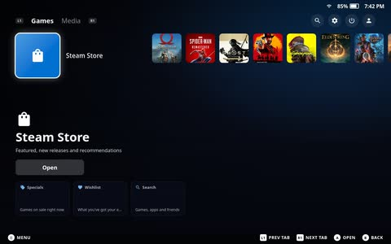</a><br><sub>Integrated Steam Store</sub> | <a href="assets/screenshots/ps5-dashboard/media.jpg">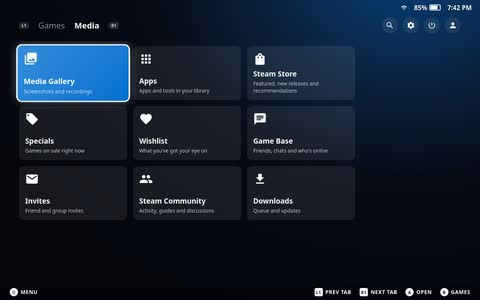</a><br><sub>Media</sub> |

### Switch 2 Dashboard

The anticipated Nintendo Switch 2 HOME menu on your Steam Deck · [repository](https://github.com/kromossomom-debug/decky-switch2-dashboard)

| | | |
|:-:|:-:|:-:|
| <a href="assets/screenshots/switch2-dashboard/home.jpg">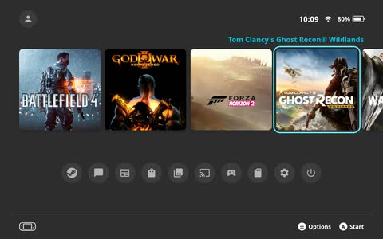</a><br><sub>Switch 2 HOME Menu</sub> | <a href="assets/screenshots/switch2-dashboard/all-software.jpg">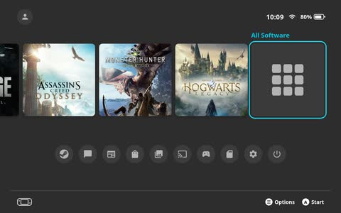</a><br><sub>All Software Grid</sub> | <a href="assets/screenshots/switch2-dashboard/library.jpg">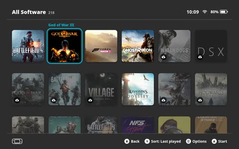</a><br><sub>Complete Library</sub> |
| <a href="assets/screenshots/switch2-dashboard/my-page.jpg">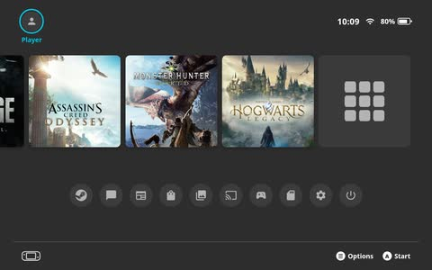</a><br><sub>My Page Profile</sub> | <a href="assets/screenshots/switch2-dashboard/icons.jpg">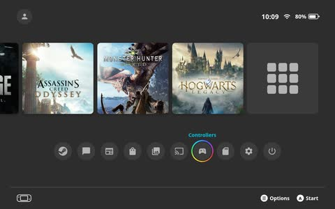</a><br><sub>Circular Shortcuts</sub> | <a href="assets/screenshots/switch2-dashboard/white.jpg">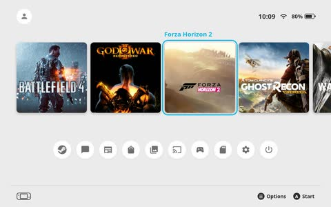</a><br><sub>Basic White Style</sub> |
| <a href="assets/screenshots/switch2-dashboard/library-archived.jpg">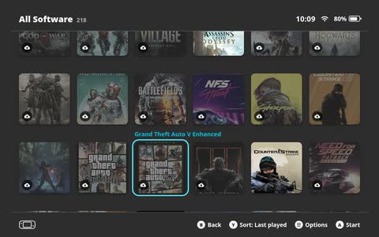</a><br><sub>Library – Archived</sub> | <a href="assets/screenshots/switch2-dashboard/non-steam.jpg">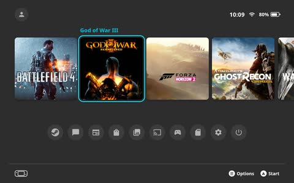</a><br><sub>Non-Steam Games</sub> | <a href="assets/screenshots/switch2-dashboard/my-page-profile.jpg">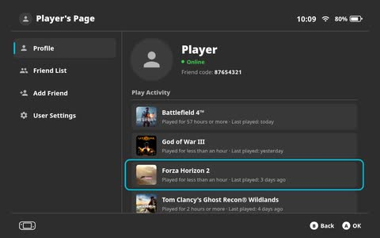</a><br><sub>Profile</sub> |
| <a href="assets/screenshots/switch2-dashboard/my-page-friends.jpg">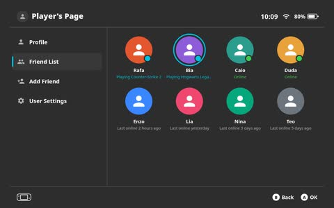</a><br><sub>Friend List</sub> | <a href="assets/screenshots/switch2-dashboard/my-page-add.jpg">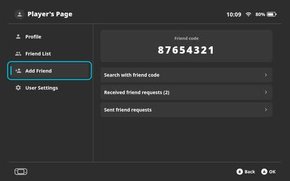</a><br><sub>Add Friend</sub> | <a href="assets/screenshots/switch2-dashboard/my-page-settings.jpg">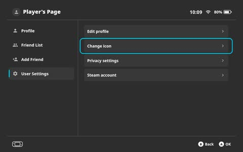</a><br><sub>User Settings</sub> |

### Xbox Dashboard

The Xbox Series X|S interface experience adapted for SteamOS · [repository](https://github.com/kromossomom-debug/decky-xbox-dashboard)

| | | |
|:-:|:-:|:-:|
| <a href="assets/screenshots/xbox-dashboard/home.jpg">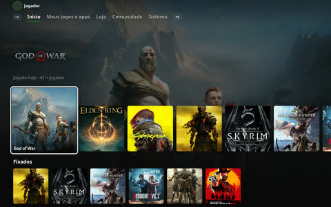</a><br><sub>Xbox Series X&#124;S Home</sub> | <a href="assets/screenshots/xbox-dashboard/mygames.jpg">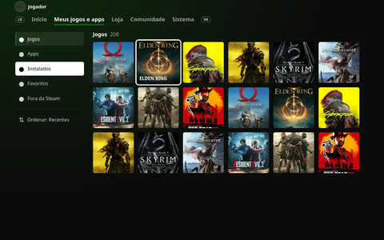</a><br><sub>My Games &amp; Apps Panel</sub> | <a href="assets/screenshots/xbox-dashboard/game.jpg">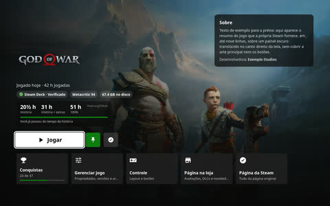</a><br><sub>Game Page with Badges</sub> |
| <a href="assets/screenshots/xbox-dashboard/system.jpg">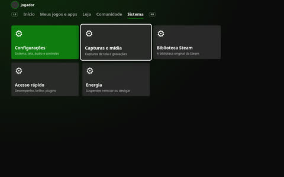</a><br><sub>System Guide &amp; Settings</sub> |  |  |

### Achievo

Console-style achievement and trophy popups (Xbox Series or PS5) · [repository](https://github.com/kromossomom-debug/decky-achievo)

| | | |
|:-:|:-:|:-:|
| <a href="assets/screenshots/achievo/playstation.jpg">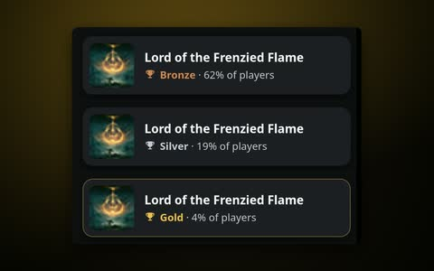</a><br><sub>PlayStation 5 Trophy Card Style</sub> | <a href="assets/screenshots/achievo/toast.jpg">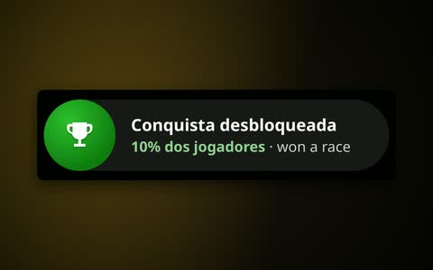</a><br><sub>Xbox Series Achievement Banner Style</sub> | <a href="assets/screenshots/achievo/toast-rare.jpg">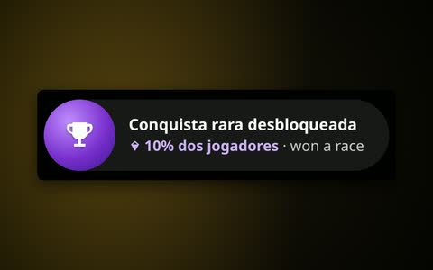</a><br><sub>Rare Achievement with Diamond</sub> |
| <a href="assets/screenshots/achievo/position-top-left.jpg">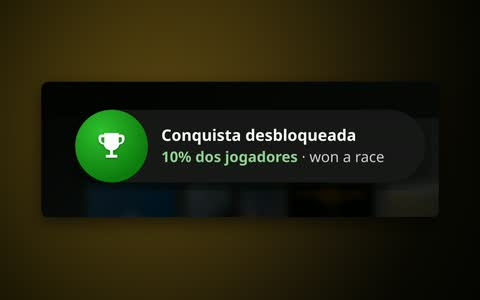</a><br><sub>Top-Left Screen Position</sub> |  |  |

## Installation

### From the release ZIP

1. Install [Decky Loader](https://decky.xyz) if you haven't already.
2. Download **`theme-loader.zip`** from the [latest release](https://github.com/kromossomom-debug/decky-theme-loader/releases/latest).
3. In Game Mode, open **Quick Access (`…`) → Decky → ⚙ Settings → General** and turn on **Developer mode**.
4. Go to **Developer → Install plugin from ZIP** and pick `theme-loader.zip`.
5. Open **Quick Access → Decky → Theme Loader** and choose **Open the store**.

To update Theme Loader itself, install the new ZIP the same way, or use the **Update Theme Loader** banner when it
shows up.

> Use one dashboard at a time. The dashboards restyle the same home screen, so turn one off (or uninstall it from
> the store) before switching to another.

## Controls

| Button | Where | Action |
|---|---|---|
| **D-pad / left stick** | Anywhere | Move between cards, tabs and buttons |
| **A** | Store card | Open the plugin page |
| **A** | Plugin page | Install, update or reinstall; on the screenshot, open it full screen |
| **B** | Anywhere | Back (closes the gallery first) |
| **Y** | Store | Roll a random theme |
| **L1 / R1** | Store | Previous / next tab |
| **L1 / R1** | Plugin page, gallery | Previous / next screenshot |

## How updates work

Theme Loader collects plugins from three places and keeps the highest version of each one:

1. The packages bundled inside `theme-loader.zip` (`packages/`).
2. Any `.zip` in `~/Documents/theme-loader/`.
3. The online catalog, `catalog.json`, published as an asset of this repository's
   [latest release](https://github.com/kromossomom-debug/decky-theme-loader/releases/latest). It is checked when the
   store opens, at most every 15 minutes, or when you press **Refresh list**. Offline, the last good copy is used.

For each plugin it reads the `version` field from the `package.json` inside the ZIP and compares it with the
`package.json` of the installed copy in `~/homebrew/plugins/`. If the installed version is older, the plugin is
marked **Update available**. If it is newer (a development build, for example), the store says so and asks before
replacing it.

Online downloads only accept `https` URLs, are limited to 200 MB, and must match the `size` and `sha256` from the
catalog. The version inside the downloaded ZIP must match the catalog entry too, or the download is refused.

## Releasing a new version

### A dashboard

1. Raise `version` in the plugin's `package.json` (e.g. `1.9.0` → `1.10.0`). That's the number Theme Loader compares.
2. Build `<id>.zip` with the plugin folder at its root (e.g. `ps5-dashboard/…`) and publish it in the plugin's own
   GitHub release.
3. Regenerate `catalog.json` with the new ZIP and its download URL, then upload it to a new Theme Loader release
   (or replace the asset on the latest one):

   ```bash
   scripts/make_catalog.py \
     ../ps5-dashboard.zip=https://github.com/kromossomom-debug/decky-ps5-dashboard/releases/download/v1.10.0/ps5-dashboard.zip \
     ../ps3-dashboard.zip > catalog.json   # entries without "=URL" use --url (default: this repo's release)
   ```

Everyone using Theme Loader sees **Update available** on their next check. To try a ZIP on your own Deck first,
drop it in `~/Documents/theme-loader/`.

### Theme Loader

1. Raise `version` in `package.json` and add an entry to [CHANGELOG.md](CHANGELOG.md).
2. Run `scripts/package.sh`. It builds the frontend and creates `../theme-loader.zip` with every plugin ZIP that sits
   next to the source folder bundled in `packages/`.
3. Publish a release tagged `vX.Y.Z` with `theme-loader.zip`, the bundled-only ZIPs (such as `ps3-dashboard.zip`)
   and a `catalog.json` that includes the `theme-loader` entry.

### `catalog.json` format

```json
{
  "schema": 1,
  "plugins": [
    {
      "id": "ps5-dashboard",
      "version": "1.10.0",
      "url": "https://github.com/kromossomom-debug/decky-ps5-dashboard/releases/download/v1.10.0/ps5-dashboard.zip",
      "size": 73472,
      "sha256": "…"
    }
  ]
}
```

`id`, `version`, `url` (https) and `sha256` are required. A plugin with no built-in preset can also bring `name`,
`description`, `author`, `color`, `tagline`, `console`, `badge` and `features`.

To test without publishing anything, run the backend with `THEME_LOADER_CATALOG_URL=file:///path/to/catalog.json`.

## Building from source

Requirements: Node.js 18+, npm, Python 3 and `ffmpeg` (only to rebuild the screenshots).

```bash
git clone https://github.com/kromossomom-debug/decky-theme-loader.git
cd decky-theme-loader
npm install
npm run build                          # dist/index.js
python3 scripts/build_screenshots.py   # assets/raw → assets/screenshots + assets/thumbs
./scripts/package.sh                   # ../theme-loader.zip, bundling the ZIPs next to the repo folder
python3 scripts/install_decky.py       # installs ../theme-loader.zip through the running Decky Loader
```

```
src/
  index.tsx             plugin entry, routes and Quick Access panel
  StorePage.tsx         full-screen store: spotlight, tabs, cards, random roll
  PluginDetailPage.tsx  plugin page: screenshots, version panel, install / update / uninstall
  ScreenshotModal.tsx   full-screen screenshot gallery
  shared.tsx            colors, focus styles, badges, confirmations, Steam top bar hiding
  store.ts              state shared by every screen and the backend calls
  i18n.ts               interface strings (en, pt, de, pl)
main.py                 Decky backend: catalog, version comparison, downloads, install and uninstall
assets/raw/             original screenshots, one folder per plugin
assets/screenshots/     screenshots normalized to 1280×800
assets/thumbs/          480×300 thumbnails for cards and filmstrips
scripts/                screenshot builder, packager, catalog generator and Decky installer
```

### Screenshots for a new plugin

Put the images in `assets/raw/<plugin-id>/` and run `scripts/build_screenshots.py`. Screenshots that are already
1280×800 are copied as they are; anything else (toasts, crops, collages) is placed on a gradient in the plugin's
colors with rounded corners and a soft shadow, so every screenshot in the store has the same frame. Add titles for
them in the plugin's preset in `main.py`; files without a preset title get one from their file name.

## Known limitations

- A Steam client update can rename the class module Theme Loader uses to hide the top bar. The store keeps working;
  the bar just stays visible until the plugin is updated.
- After installing or removing a plugin, Decky Loader may need a moment (or a restart from its settings) to load or
  unload it.
- Only one dashboard should be active at a time.

## Support

If Theme Loader made your Deck look better, you can buy the author a coffee. It helps keep the store and the
dashboards updated. The store header and the Quick Access panel have a **Support the project** button too.

<a href="https://buymeacoffee.com/kromossomoc"></a>

Bug reports and ideas are welcome in [Issues](https://github.com/kromossomom-debug/decky-theme-loader/issues).

## Disclaimer

This is an unofficial fan project. It is not affiliated with, endorsed by or sponsored by Sony Interactive
Entertainment, Nintendo, Microsoft or Valve. PlayStation, PS3, PS5, Nintendo Switch, Xbox and Steam are trademarks of
their respective owners. Game artwork shown in the screenshots belongs to its respective owners.

## License

[MIT](LICENSE) © 2026 kromossomo
